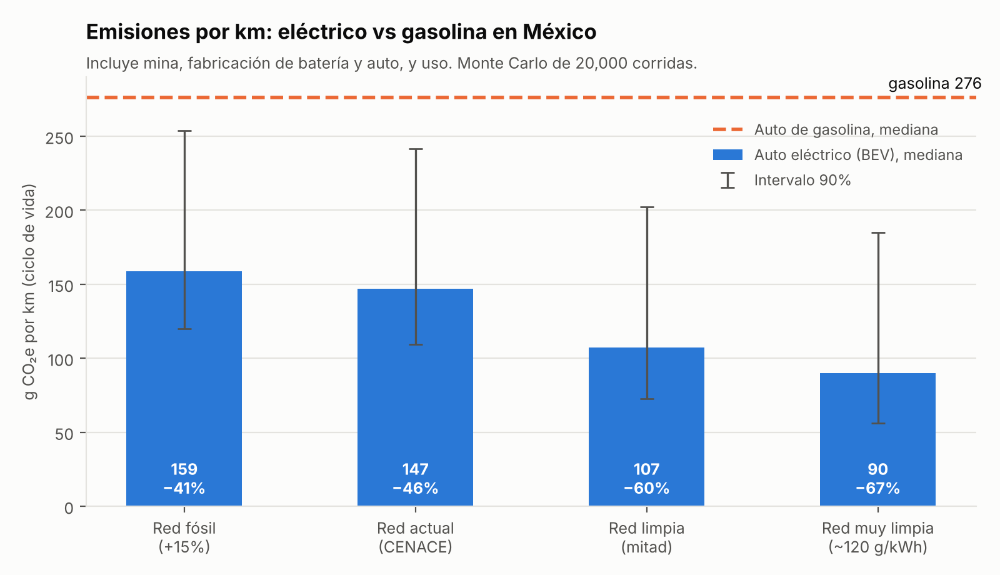
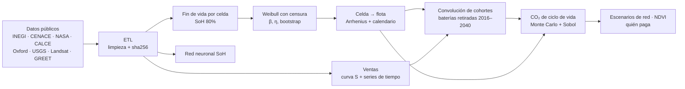
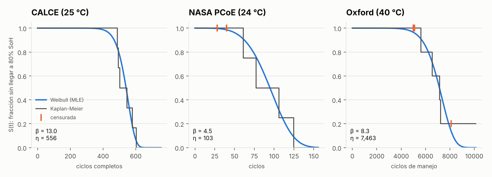
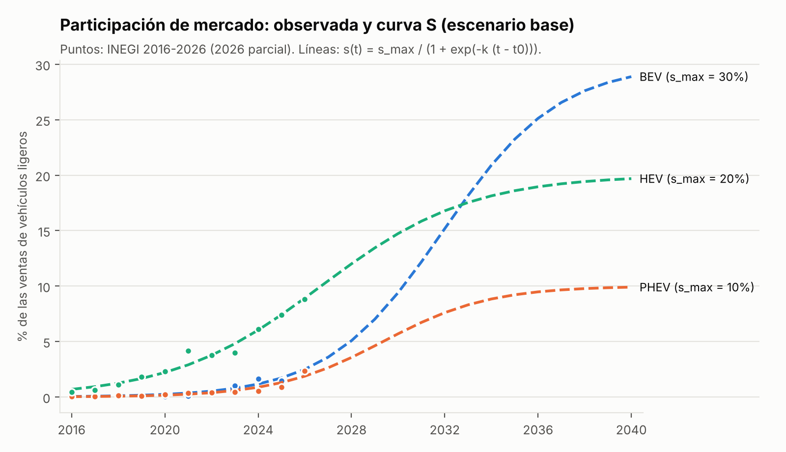
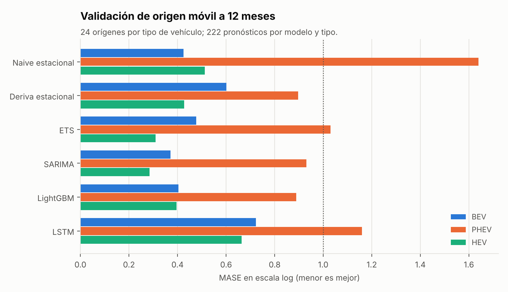
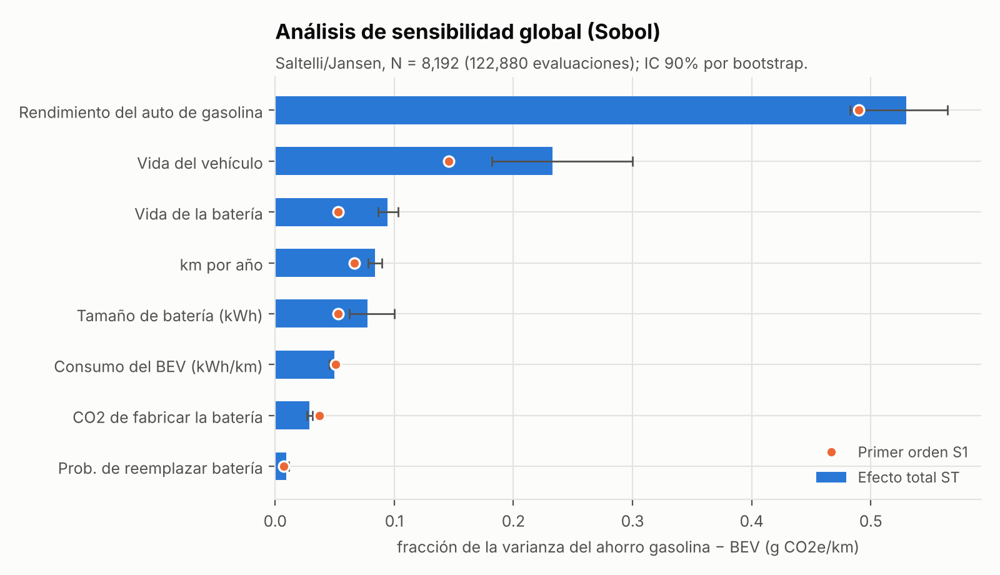

<div align="center">

# ¿Qué tan limpio es un auto eléctrico en México?

**Ciclo de vida de las baterías de vehículos eléctricos, de la mina al reciclaje, y quién paga el costo ambiental**

Instituto Politécnico Nacional · Proyecto interdisciplinario de la Licenciatura en Ciencia de Datos
y la Ingeniería en Sistemas Automotrices

`Python 3.12` · `semilla 42` · `39 pruebas` · `México 2016–2040`

</div>

> **Documento técnico completo:** [`docs/extenso_bateria_ve_mx.html`](docs/extenso_bateria_ve_mx.html)
> (tablero ejecutivo + procedimiento matemático y estadístico, con fórmulas, tablas y figuras; ábrelo en el navegador).

---

## Resultados principales

| | Resultado | Incertidumbre |
|---|---|---|
| **CO₂e por km** | Eléctrico **147 g** frente a **276 g** de gasolina: **45% menos** con la red actual | IC 90%: 23–60% |
| **Equilibrio** | La batería "se paga" en carbono a los **~27,000 km** (~2.2 años) | 14,000–47,000 km |
| **Robustez** | El eléctrico emite menos en el **99.5%** de 20,000 simulaciones | Monte Carlo, n = 20,000 |
| **Baterías retiradas** | 198 t (2025) → 2,137 t (2030) → 11,356 t (2035) → **38,657 t (2040)** | 2040: 30.7–43.8 mil t por escenario |
| **Clima** | Vida de la batería BEV: **9.7 años** en estados ≥ 24 °C vs **15.8** en el resto | Arrhenius, flota simulada |
| **Quién paga** | 47% de las emisiones del eléctrico se generan al fabricarlo (casi siempre fuera de México) | |
| **Vegetación** | Cananea: NDVI −23% (2014–25), Mann–Kendall p < 0.001 | no prueba causalidad |

<p align="center">
  
  
</p>
<p align="center">
  
  
</p>

**En tres frases.** Aun con la electricidad que hoy usa México, un auto eléctrico emite casi la mitad de CO₂
por kilómetro que uno de gasolina. El beneficio no se reparte igual: casi la mitad de sus emisiones ocurre al
fabricarlo y las baterías se desgastan antes en los estados calurosos. Para 2040 México manejaría decenas de
miles de toneladas de baterías usadas al año; hay que preparar reciclaje y segunda vida desde ahora.

## Cómo está construido



| Fase | Qué hace | Método | Carpeta |
|---|---|---|---|
| 1–2 | Descarga y limpieza, trazabilidad | ETL, SHA-256, tabla de faltantes | `etl/` |
| 3 | Vida útil de la batería | Weibull con censura (MLE), bootstrap, β común (razón de verosimilitudes), Arrhenius | `modelos/vida_util/` |
| 4 | Ventas a 2040 | Curva S (Fisher–Pry) y 6 modelos de corto plazo con origen móvil y MASE | `modelos/ventas/` |
| 3 | Baterías que salen de vehículos | Convolución de cohortes por estado | `modelos/flujo_eol/` |
| 5 | Estado de salud (SoH) | Red neuronal MLP en NumPy, ensamble, validación dejando una celda fuera | `modelos/soh/` |
| 6 | CO₂ por km y sensibilidad | Monte Carlo (20,000) y Sobol (122,880 evaluaciones) | `modelos/riesgo/` |
| 7 | Quién paga | Escenarios de red, Mann–Kendall y Theil–Sen sobre NDVI | `modelos/ejecutar_etica.py` |
| 8 | Entregables | Figuras, extenso HTML, este README | `modelos/ejecutar_figuras.py`, `modelos/generar_extenso.py` |

### Lo que dicen los modelos (resumen técnico)

<p align="center">
  
</p>

| Conjunto | β (IC 90%) | η (IC 90%) | Celdas (fallas / censuradas) |
|---|---|---|---|
| CALCE (25 °C, ciclos) | 13.04 (10.98–25.18) | 556 (522–583) | 6 (6 / 0) |
| NASA PCoE (24 °C, ciclos) | 4.51 (3.68–14.85) | 103 (75–120) | 12 (4 / 8) |
| Oxford (manejo urbano) | 8.32 (5.61–28.44) | 7,463 (6,629–8,371) | 8 (4 / 4) |

Prueba de forma común: Λ = 4.70, 2 g.l., p = 0.096 (no se rechaza; evidencia débil). En la flota β baja a ≈ 3.3–4.5
porque se suman la variabilidad del uso y del clima.

<p align="center">
  
  
</p>

A 12 meses, **SARIMA gana en BEV (MASE 0.37) y HEV (0.29)**, LightGBM gana por poco en PHEV (0.89) y la LSTM queda
última en BEV y HEV: con ~130 meses de datos, el modelo simple supera al complejo.

<p align="center">
  
</p>

El resultado depende sobre todo del rendimiento del auto de gasolina comparado (S<sub>T</sub> = 0.53) y de la
vida del vehículo (0.23). La red eléctrica pesa entre escenarios (reducción de 41% con red fósil a 67% con red muy limpia).

## Límites que hay que decir en voz alta

- **Celdas de laboratorio** de EE. UU. y Reino Unido, no paquetes automotrices ni clima mexicano. Fuera de su temperatura de entrenamiento, la red neuronal pierde frente a una extrapolación lineal (RMSE 1.16 vs 0.66 pp).
- **El techo de participación de mercado no es identificable** con datos de inicio de curva: se reportan tres escenarios (bajo, base, alto).
- **Supuestos sin dato mexicano** (vida del auto, vida calendario, factor laboratorio→vehículo, pérdidas de red, crédito de reciclaje): todos con rango y fuente en `modelos/config_fase3.yaml`, y marcados como `SUPUESTO`.
- **CENACE** publica solo a nivel nacional; algunos factores de emisión por tecnología son provisionales.
- **NDVI sin zonas de control ni lluvia**: la tendencia no prueba que la mina sea la causa.
- **No existen datos públicos de baterías retiradas en México**: el resultado final es un escenario, no un pronóstico puntual.

## Reproducir

```powershell
python -m venv .venv ; .venv\Scripts\activate
pip install -r requirements.txt                          # + statsmodels, lightgbm, torch, matplotlib para fases 4 y 8

python -m etl.descargas verificar                        # qué archivos manuales faltan (+ sha256)
python -m etl.ejecutar_etl                               # limpieza
python -m unittest discover -s tests                     # 39 pruebas (15 de ETL + 24 de modelos)

python -m modelos.ejecutar_vida_util                     # fin de vida y Weibull con censura
python -m modelos.ejecutar_vida_flota                    # vida de batería por estado (Arrhenius)
python -m modelos.ejecutar_ventas                        # curva S y validación de origen móvil
python -m modelos.ejecutar_flujo_eol                     # baterías retiradas 2016–2040
python -m modelos.ejecutar_series                        # STL, ADF/KPSS, Ljung–Box
python -m modelos.ejecutar_soh                           # red neuronal para SoH
python -m modelos.ejecutar_riesgo                        # CO2 Monte Carlo y Sobol
python -m modelos.ejecutar_etica                         # NDVI y reparto de emisiones
python -m modelos.ejecutar_figuras                       # 8 figuras en resultados/figuras/
python -m modelos.generar_extenso                        # docs/extenso_bateria_ve_mx.html
```

Reglas del proyecto: Python reproducible, semilla `42`, rutas relativas, ningún dato inventado, intervalos de
incertidumbre en todo resultado y, cuando un modelo simple gana, se dice.

## Estructura

```
config/                 configuración del ETL, fichas de fuentes, plantillas
datos/crudo|procesado/  datos originales (con sha256) y tablas limpias
etl/                    descarga y limpieza
modelos/                código por fase + config_fase3.yaml (todos los supuestos con fuente)
resultados/fase3..7/    tablas de cada fase · resultados/figuras/ las 8 gráficas
docs/                   extenso HTML, plantilla, logos/ (coloca aquí los logotipos oficiales)
tests/                  39 pruebas
```

## Fuentes de datos

INEGI RAIAVL · CENACE · NASA PCoE · CALCE (U. de Maryland) · Oxford Battery Degradation Dataset · NASA POWER ·
USGS Mineral Commodity Summaries 2026 · Landsat 8/9 Colección 2 · GREET (Argonne) y literatura.
URLs oficiales y fechas de descarga en `config/fichas.yaml` y `datos/manifiesto_descargas.csv`.

## Equipo

- **Joel Morales Gutierrez**
