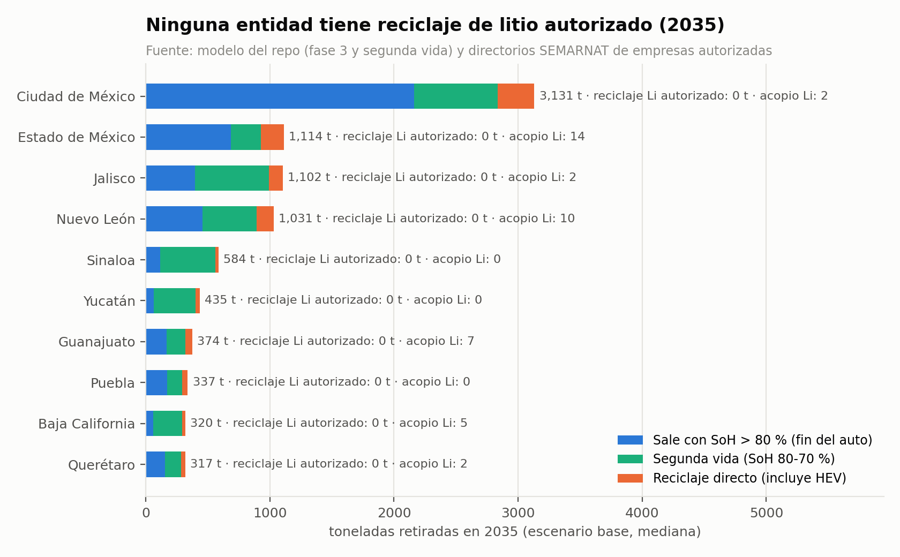
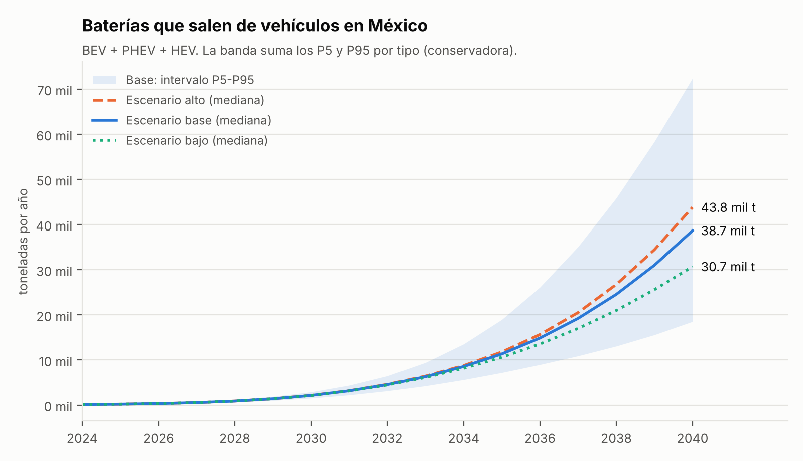
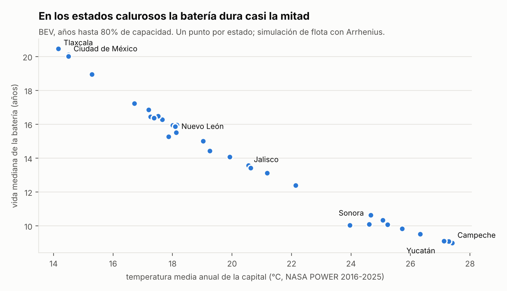
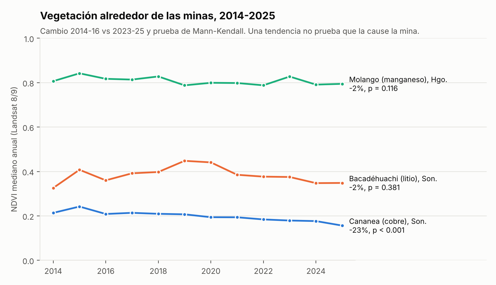
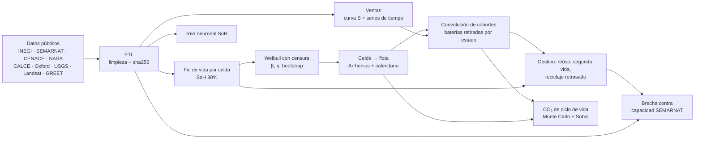

<div align="center">

# ¿Adónde van las baterías?

**Trazabilidad y gestión inteligente del fin de vida de baterías de vehículos eléctricos e híbridos en México, 2016–2035**

Línea 2 · Gestión inteligente de baterías (VE / híbridos) · Metodología DMAIC

Instituto Politécnico Nacional · Proyecto interdisciplinario de la Licenciatura en Ciencia de Datos
y la Ingeniería en Sistemas Automotrices

`Python 3.12` · `semilla 42` · `47 pruebas` · `10 fuentes` · `México 2016–2035 (horizonte 2040)`

</div>

> **Propuesta:** [`docs/propuesta_mejorada.md`](docs/propuesta_mejorada.md) (causa, causa raíz, mapeo, DMAIC y propuesta de gestión).
> **Documento técnico completo:** [`docs/extenso_bateria_ve_mx.html`](docs/extenso_bateria_ve_mx.html)
> (tablero, planteamiento y procedimiento matemático y estadístico; ábrelo en el navegador).
> **Marco legal:** [`docs/marco_regulatorio.md`](docs/marco_regulatorio.md), con los textos oficiales en `docs/fuentes_primarias/`.

---

**En tres frases.** Entre 2026 y 2035 saldrán de los vehículos en México unas 400 mil baterías (39 mil t), y en 2035
serán 11,356 t al año, concentradas en CDMX, Estado de México, Jalisco y Nuevo León. Hoy el país tiene **0 t/año de
reciclaje autorizado para baterías de litio** y ninguna norma específica que obligue a registrarlas o a medir su salud.
Más de la mitad del peso podría reutilizarse antes de reciclarse, pero sin trazabilidad no hay forma de saber cuál.

## El problema

**Problemática.** En México nadie puede decir cuántas baterías de VE e híbridos salen de los vehículos, en qué estado de
salud y adónde van. Las ventas pasaron de 8,265 unidades en 2016 a **149,031 en 2025** (22,208 BEV, 13,722 PHEV y
113,101 HEV; INEGI RAIAVL), y las bajas pasan de unas 6 mil baterías en 2026 a 103 mil en 2035.

**Pregunta guía.** ¿Cuántas baterías llegarán al final de su vida en cada estado entre 2026 y 2035, en qué condición, y
existe capacidad autorizada para reutilizarlas o reciclarlas?

| Hipótesis | Resultado |
|---|---|
| 1. Las bajas se concentran en pocas entidades | **Confirmada.** En 2035, CDMX 3,131 t, Estado de México 1,114 t, Jalisco 1,102 t y Nuevo León 1,031 t: 56% del total |
| 2. En estados calurosos la batería dura menos | **Confirmada en el modelo.** BEV: 9.7 años en estados ≥ 24 °C frente a 15.8 en el resto (Arrhenius) |
| 3. La capacidad de reciclaje autorizada es menor que las bajas | **Confirmada y más grave de lo previsto.** 0 t/año autorizadas para litio en las 32 entidades (SEMARNAT) |

**Causa raíz:** falta de trazabilidad de la batería desde la venta hasta el desecho. El ion-litio está en una zona gris
legal (residuo de manejo especial salvo que sea CRETIB; no aparece en el art. 31 de la LGPGIR), la infraestructura se
hizo para plomo-ácido (2.02 millones t/año autorizadas para plomo, 0 para litio) y la Ley General de Economía Circular
(2026) aún no tiene acuerdo de responsabilidad extendida para baterías.

## Resultados principales

| | Resultado | Incertidumbre |
|---|---|---|
| **Baterías retiradas** | 330 t (2026) → 2,137 t (2030) → **11,356 t (2035)**; ~400 mil baterías y 39,223 t acumuladas 2026–2035 | 2035: 90–124 mil baterías (90%) |
| **Destino en 2035** | 5,305 t salen con SoH > 80% · 4,711 t a segunda vida · 1,340 t a reciclaje directo (HEV) | |
| **Segunda vida** | **88%** de las toneladas de 2035 aptas para reúso o segunda vida (100% sin HEV) | 81% con margen mínimo de 30% |
| **Reciclaje de litio** | **0 t/año** autorizadas; 56 autorizaciones de acopio aceptan litio en 15 estados; 32 de 32 estados en déficit | SEMARNAT, 937 autorizaciones |
| **Concentración** | CDMX, Edomex, Jalisco y Nuevo León: **56%** de las toneladas de 2035 | |
| **Reciclaje retrasado** | Con 100% de adopción de segunda vida, el reciclaje de 2035 baja de 11,356 t a 3,232 t (7,294 t con 50%) | se pospone 3–7 años |
| **Clima** | Vida de la batería BEV: **9.7 años** en estados ≥ 24 °C vs **15.8** en el resto | Arrhenius, flota simulada |
| **Umbral de retiro** | Retiro al 70% de SoH en vez de 80%: −16% de toneladas en 2035 (9,499 t) | la brecha sigue total |
| **Por qué importa (contexto)** | El eléctrico emite **147 g** de CO₂e/km frente a **276 g** de gasolina (45% menos); 47% de sus emisiones ocurre al fabricar la batería | IC 90%: 23–60% |
| **Horizonte 2040** | 38,657 t retiradas al año | 30.7–43.8 mil t por escenario |

<p align="center">
  
</p>
<p align="center">
  
  
</p>
<p align="center">
  
  
</p>

## Marco legal y propuesta de gestión

- **México:** marco general (LGPGIR, reforma DOF 19-01-2026; NOM-161 y su modificación de 2014; NOM-052), sin norma
  específica para baterías de tracción. La Ley General de Economía Circular (DOF 19-01-2026) crea la responsabilidad
  extendida del productor, pero solo aplica con acuerdos sectoriales que aún no existen para baterías.
- **Unión Europea (Reglamento 2023/1542):** pasaporte de batería con SoH desde el 18 feb 2027 (art. 77), responsabilidad
  ampliada del productor (art. 56), recuperación de litio de 50% en 2027 y 80% en 2031 (Anexo XII) y 6% de litio
  reciclado en baterías nuevas en 2031 (art. 8).

**Propuesta**
1. Acuerdo de responsabilidad extendida del productor para baterías de tracción, con recolección financiada por armadoras e importadores.
2. Pasaporte de batería mexicano vinculado al NIV: química, kWh, SoH al retiro y destino.
3. Incluir el ion-litio en el art. 31 de la LGPGIR o en una NOM específica.
4. Capacidad de reciclaje de litio priorizada en CDMX, Estado de México, Jalisco y Nuevo León.
5. Segunda vida regulada entre 80% y 70% de SoH, que pospone 3–7 años la demanda de reciclaje.
6. Plan para estados calurosos (Sinaloa, Yucatán), donde las baterías se retiran antes.

## Plan de trabajo (DMAIC)

| Etapa | Qué se hace | Fases | Estado |
|---|---|---|---|
| Definir | Problemática, alcance nacional, periodo 2016–2025 | — | Hecho |
| Medir | Recolección y limpieza, 10 fuentes | 1–2 | Hecho |
| Analizar | Causa raíz, vida útil, ventas, flujo de bajas, SoH, riesgo | 3–6 | Hecho |
| Mejorar | Segunda vida, reciclaje retrasado, brecha SEMARNAT, marco legal, propuesta | 7 | Hecho |
| Controlar | Repositorio, informe técnico, API y tablero | 8 | Se actualiza con `generar_extenso` y `generar_api_estatica` |

## Cómo está construido



| Fase | Qué hace | Método | Carpeta |
|---|---|---|---|
| 1–2 | Descarga y limpieza, trazabilidad | ETL, SHA-256, tabla de faltantes | `etl/` |
| 3 | Vida útil de la batería | Weibull con censura (MLE), bootstrap, β común (razón de verosimilitudes), Arrhenius | `modelos/vida_util/` |
| 4 | Ventas a 2040 | Curva S (Fisher–Pry) y 6 modelos de corto plazo con origen móvil y MASE | `modelos/ventas/` |
| 3 | Baterías que salen de vehículos | Convolución de cohortes por estado | `modelos/flujo_eol/` |
| 5 | Estado de salud (SoH) | Red neuronal MLP en NumPy, ensamble, validación dejando una celda fuera | `modelos/soh/` |
| 6 | CO₂ por km y sensibilidad | Monte Carlo (20,000) y Sobol (122,880 evaluaciones) | `modelos/riesgo/` |
| 7 | Quién paga | Escenarios de red, Mann–Kendall y Theil–Sen sobre NDVI | `modelos/ejecutar_etica.py` |
| 7 (Línea 2) | Segunda vida y reciclaje retrasado | Margen 80→70% por celda, bootstrap, convolución con retraso | `modelos/segunda_vida/`, `modelos/ejecutar_segunda_vida.py`, `modelos/ejecutar_reciclaje_retrasado.py` |
| 7 (Línea 2) | Brecha de reciclaje por estado | Directorios SEMARNAT, clasificación de litio por texto | `etl/semarnat.py`, `modelos/ejecutar_brecha_reciclaje.py` |
| 7 (Línea 2) | Marco regulatorio | LGPGIR 2026, NOM-161/052, Ley General de Economía Circular, Reglamento UE 2023/1542 | `docs/marco_regulatorio.md`, `config/regulacion.yaml` |
| 8 | Entregables | Figuras, extenso HTML, este README | `modelos/ejecutar_figuras.py`, `modelos/generar_extenso.py` |

### Lo que dicen los modelos (resumen técnico)

<p align="center">
  
</p>

| Conjunto | β (IC 90%) | η (IC 90%) | Celdas (fallas / censuradas) |
|---|---|---|---|
| CALCE (25 °C, ciclos) | 13.04 (10.98–25.18) | 556 (522–583) | 6 (6 / 0) |
| NASA PCoE (24 °C, ciclos) | 4.51 (3.68–14.85) | 103 (75–120) | 12 (4 / 8) |
| Oxford (manejo urbano) | 8.32 (5.61–28.44) | 7,463 (6,629–8,371) | 8 (4 / 4) |

Prueba de forma común: Λ = 4.70, 2 g.l., p = 0.096 (no se rechaza; evidencia débil). En la flota β baja a ≈ 3.3–4.5
porque se suman la variabilidad del uso y del clima.

<p align="center">
  
  
</p>

A 12 meses, **SARIMA gana en BEV (MASE 0.37) y HEV (0.29)**, LightGBM gana por poco en PHEV (0.89) y la LSTM queda
última en BEV y HEV: con ~130 meses de datos, el modelo simple supera al complejo.

<p align="center">
  
</p>

El resultado depende sobre todo del rendimiento del auto de gasolina comparado (S<sub>T</sub> = 0.53) y de la
vida del vehículo (0.23). La red eléctrica pesa entre escenarios (reducción de 41% con red fósil a 67% con red muy limpia).

## Límites que hay que decir en voz alta

- **No hay datos del canal informal** ni de baterías importadas en autos usados.
- **Celdas de laboratorio** de EE. UU. y Reino Unido, no paquetes automotrices ni clima mexicano. Fuera de su temperatura de entrenamiento, la red neuronal pierde frente a una extrapolación lineal (RMSE 1.16 vs 0.66 pp).
- **El techo de participación de mercado no es identificable** con datos de inicio de curva: se reportan tres escenarios (bajo, base, alto).
- **Supuestos sin dato mexicano** (vida del auto, vida calendario, factor laboratorio→vehículo, pérdidas de red, crédito de reciclaje): todos con rango y fuente en `modelos/config_fase3.yaml`, y marcados como `SUPUESTO`.
- **CENACE** publica solo a nivel nacional; algunos factores de emisión por tecnología son provisionales.
- **NDVI sin zonas de control ni lluvia**: la tendencia no prueba que la mina sea la causa.
- **No existen datos públicos de baterías retiradas en México**: el resultado final es un escenario, no un pronóstico puntual.
- **SEMARNAT da capacidad autorizada en papel, no toneladas realmente recicladas**, y la detección de litio es por texto libre (revisar `resultados/brecha/litio_autorizaciones.csv`).
- **Segunda vida**: el margen mínimo, su duración y su adopción son supuestos con rango y fuente; no hay datos del canal informal.

## Reproducir

```powershell
python -m venv .venv ; .venv\Scripts\activate
pip install -r requirements.txt                          # + statsmodels, lightgbm, torch, matplotlib para fases 4 y 8

python -m etl.descargas verificar                        # qué archivos manuales faltan (+ sha256)
python -m etl.ejecutar_etl                               # limpieza
python -m unittest discover -s tests                     # 47 pruebas (15 de ETL + 24 de modelos + 8 de Línea 2)

python -m modelos.ejecutar_vida_util                     # fin de vida y Weibull con censura
python -m modelos.ejecutar_vida_flota                    # vida de batería por estado (Arrhenius)
python -m modelos.ejecutar_ventas                        # curva S y validación de origen móvil
python -m modelos.ejecutar_flujo_eol                     # baterías retiradas 2016–2040
python -m modelos.ejecutar_series                        # STL, ADF/KPSS, Ljung–Box
python -m modelos.ejecutar_soh                           # red neuronal para SoH
python -m modelos.ejecutar_riesgo                        # CO2 Monte Carlo y Sobol
python -m modelos.ejecutar_etica                         # NDVI y reparto de emisiones
python -m modelos.ejecutar_segunda_vida                  # KPI de segunda vida
python -m modelos.ejecutar_reciclaje_retrasado           # llegada al reciclaje con segunda vida
python -m modelos.ejecutar_brecha_reciclaje              # brecha contra SEMARNAT
python -m modelos.ejecutar_figuras                       # 8 figuras en resultados/figuras/
python -m modelos.ejecutar_figura_brecha                 # figura 9
python -m modelos.generar_extenso                        # docs/extenso_bateria_ve_mx.html
python -m modelos.generar_api_estatica                   # api-estatica/*.json
```

Reglas del proyecto: Python reproducible, semilla `42`, rutas relativas, ningún dato inventado, intervalos de
incertidumbre en todo resultado y, cuando un modelo simple gana, se dice.

## Estructura

```
config/                 configuración del ETL, fichas de fuentes, plantillas
datos/crudo|procesado/  datos originales (con sha256) y tablas limpias
etl/                    descarga y limpieza
modelos/                código por fase + config_fase3.yaml (todos los supuestos con fuente)
resultados/fase3..7/    tablas de cada fase · resultados/figuras/ las 9 gráficas
resultados/segunda_vida/, brecha/, sensibilidad_umbral_70/   Línea 2
docs/                   extenso HTML, plantilla, logos/ (coloca aquí los logotipos oficiales)
index.html              página de entrada para hosting (tablero + endpoints)
api-estatica/           API estática: JSON generados desde resultados/
tests/                  47 pruebas
```

## Fuentes de datos

INEGI RAIAVL · SEMARNAT (directorios de empresas autorizadas) · CENACE · NASA PCoE · CALCE (U. de Maryland) ·
Oxford Battery Degradation Dataset · NASA POWER · USGS Mineral Commodity Summaries 2026 · Landsat 8/9 Colección 2 ·
GREET (Argonne) y literatura. Textos legales en `docs/fuentes_primarias/`.
URLs oficiales y fechas de descarga en `config/fichas.yaml` y `datos/manifiesto_descargas.csv`.

## Equipo

- **Joel Morales Gutierrez**

### Página en vivo y API estática

La raíz del repositorio es un sitio estático: `index.html` es la página de entrada y `api-estatica/` contiene los datos en JSON. No hay servidor ni base de datos.

| | Enlace |
|---|---|
| **Página (raw.githack, en vivo)** | https://raw.githack.com/joelmoralesgutierrez8-lab/bateria-ve-mx/main/index.html |
| **Extenso técnico** | https://raw.githack.com/joelmoralesgutierrez8-lab/bateria-ve-mx/main/docs/extenso_bateria_ve_mx.html |
| **Datos (índice JSON)** | https://raw.githack.com/joelmoralesgutierrez8-lab/bateria-ve-mx/main/api-estatica/index.json |
| **GitHub Pages** (si se activa, ver abajo) | https://joelmoralesgutierrez8-lab.github.io/bateria-ve-mx/ |

**Datos para conectarlo a un host (Vercel, Netlify, Render, Cloudflare Pages, GitHub Pages)**

| Campo | Valor |
|---|---|
| Repositorio Git (URL) | `https://github.com/joelmoralesgutierrez8-lab/bateria-ve-mx` |
| Rama (Branch) | `main` |
| Framework Preset | `Other` / `Static HTML` |
| Root Directory / Publish Directory | `./` (la raíz) |
| Build Command | *(vacío)* |
| Archivo de entrada | `index.html` |

*GitHub Pages:* Settings, luego Pages, luego Source = *Deploy from a branch*, Branch = `main`, carpeta `/ (root)`. El archivo `.nojekyll` ya está incluido.

**Endpoints de la API estática** (GET, JSON de solo lectura; base `https://raw.githack.com/joelmoralesgutierrez8-lab/bateria-ve-mx/main/api-estatica/`)

| Endpoint | Contenido |
|---|---|
| `resumen.json` | Cifras clave: toneladas retiradas, Línea 2 (2035), CO₂ por km |
| `retiros.json` | Baterías retiradas 2016–2040 (unidades, MWh, toneladas; P5/P50/P95; escenarios) |
| `ventas.json` | Proyección de ventas BEV/PHEV/HEV por escenario |
| `vida-flota.json` | Weibull de flota y vida de batería por estado |
| `weibull.json` | Weibull de laboratorio con censura |
| `co2.json` · `escenarios-red.json` · `sobol.json` · `ndvi.json` | CO₂ Monte Carlo, escenarios de red, Sobol, NDVI |
| `retiros-por-clima.json` | Toneladas 2035 por estado frente a su clima |
| `segunda-vida.json` · `segunda-vida-entidad.json` | Destino de las bajas: reúso, segunda vida, reciclaje |
| `reciclaje-retrasado.json` | Toneladas que llegan a reciclaje según la adopción de segunda vida |
| `brecha-reciclaje.json` · `litio-autorizaciones.json` | Bajas por estado frente a la capacidad autorizada de SEMARNAT |
| `sensibilidad-umbral-70.json` | Toneladas con retiro al 80% y al 70% de SoH |

```js
const base = "https://raw.githack.com/joelmoralesgutierrez8-lab/bateria-ve-mx/main/";
const datos = await (await fetch(base + "api-estatica/resumen.json")).json();
console.log(datos.co2_g_km.reduccion_pct_p50);   // 45.4
```

**Incrustarla en otra página web (`<iframe>`)**

```html
<iframe src="https://raw.githack.com/joelmoralesgutierrez8-lab/bateria-ve-mx/main/index.html"
        width="100%" height="720" style="border:0" loading="lazy"
        title="Baterías de VE en México"></iframe>
```

Notas: el repositorio debe ser **público** para que raw.githack funcione. Los enlaces de raw.githack con `/main/` son de desarrollo y se actualizan solos (pueden tardar unos minutos tras un push); para uno fijo usa el enlace de producción de raw.githack con el hash del commit. Después de cambiar resultados, corre `python -m modelos.generar_api_estatica` y vuelve a hacer push.
